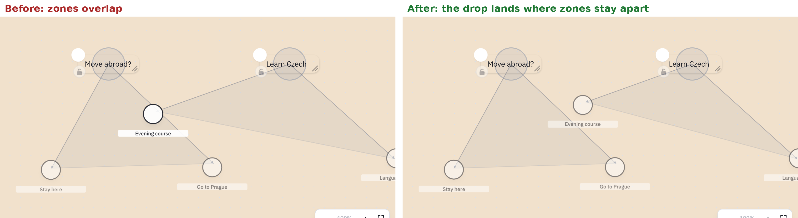
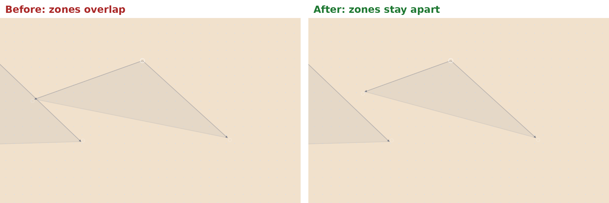

# Zones stay apart on a drop

Date: 2026-11-25 · PR: (linked once open)

## What the user wants to do

"Fight with one zone overlapping another": after moving thoughts around, one zone's shape covers part
of another zone, and it no longer reads which thought belongs where.

## The gesture

Nothing new to learn: the same Move-mode drag of a node, or of a picked group.

- **Touch / mouse:** drag a node (✥ on) and let go.
- **What the user sees:** while dragging, the zone follows the finger as before. On letting go, if
  the drop would lay its zone over another zone (lines crossing, a corner inside or right on the other
  zone's line), or put a node of a zone inside another zone, the node glides to the nearest spot where
  the two zones stay apart, a small gap between them. Anywhere else it lands exactly where let go.
- A child zone hanging off a member of its parent zone still touches it at that shared node, but no
  longer cuts across it. A zone wrapping a whole branch (layout "nested") still holds its sub-zones.
- A node in no zone can still be dropped anywhere clear (unchanged).
- Zones that already overlapped don't block a move; a drag can still pull them apart.
- **Undo:** the usual undo of a move.

## Sketch




```
before                         after
  /\    /\                       /\     /\
 /  \  /  \                     /  \   /  \
/ ..X\/... \     ->            /    \ X    \
 zone B's corner X              X lands just
 inside zone A                  outside zone A
```

## Could be confused with

- *Join a zone by dropping on a node*: that drop is aimed at a node's card; it still joins, and its
  new zone then keeps off the others the same way.
- *Leave a zone by dragging past one and a half reaches*: unchanged; a node that leaves its zone is no
  longer held by this rule.

## Quick test

Not yet tested by a person: the PR asks Viktor to try it on a phone and a computer before merging.

| Person | Tried first | Stuck on | Changed |
|---|---|---|---|
| | | | |

## Decision

Rule 2 of `utils/zoneRules.ts` ("zones don't overlap") now holds for a drag the person aimed (free
mode), and for zones that share a node too; a drop that breaks it lands at the nearest spot that
doesn't.
